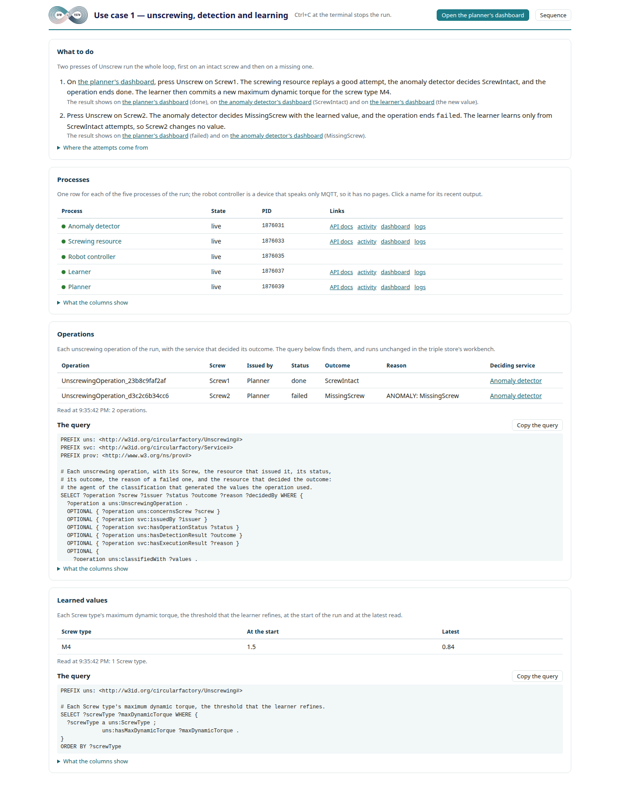

# jms-kapps

The two use cases of the paper *KAPPS: A knowledge-based CPPS Architecture for the Circular
Factory* (arXiv 2605.22457), built on
[`kapps-semantic-middleware`](https://pypi.org/project/kapps-semantic-middleware/), the semantic
middleware of the KAPPS architecture's reference implementation.

In the KAPPS architecture, the knowledge graph is the authoritative representation of the
factory's information state, and every change to it is validated against declared constraints
before it is admitted. The parts of a Cyber-Physical Production System (CPPS) do not call each
other at fixed addresses. Each part is a service (in the code, a *participant*: one process with
its own middleware instance). A service registers in the knowledge graph, finds the other
services there, and commits each change of the factory information state through the write path
of its middleware instance. The triple store admits a commit only when it passes SHACL validation
against the declared shapes, and otherwise refuses it in whole.

- **Use case 2: a decentralized conveyor network coordinated through a constraint-enforced
  knowledge graph.** Each FlexConveyor module runs as its own service. A module reserves the next
  module for a box, conveys the box and hands it over. No central router exists: each module
  chooses the next module from the knowledge graph. Two faults that a person arms on a module make
  it commit a write that breaks a physical invariant, and the triple store refuses that write.
- **Use case 1: anomaly detection and learning in robotic unscrewing.** Four services work on an
  unscrewing operation. A planner creates one operation per press of a button. A screwing resource
  records the time series of the attempt. An anomaly detector classifies the attempt. A learner
  refines a detection threshold of each screw type. The services coordinate through the
  knowledge graph and find each other there. The notifications and the call of the detector go
  over REST, to addresses that the knowledge graph holds; the time series are kept in InfluxDB.
  The screwing resource drives its robot over MQTT; a stand-in replaces the robot controller.

Both use cases are in one repository, because they share the demo seed that loads the ontologies
and shapes, the triple store setup and the measurement harness, and because the paper cites them
together.
A launch loads the shipped ontologies and shapes into its dataset for the demonstration;
a productive circular factory already holds them in its knowledge graph.

## Run use case 2

On Linux or macOS, with [Docker](https://docs.docker.com/get-docker/) and
[uv](https://docs.astral.sh/uv/), the clone first, then in the repository root:

```bash
git clone https://github.com/circularfactory/jms_kapps.git && cd jms_kapps
docker compose up -d --wait   # a local triple store, with the datasets jms-kapps and kapps-demo, and an InfluxDB
uv sync --locked              # the packages, into .venv
export TRIPLESTORE_URL=http://localhost:7200 TRIPLESTORE_USERNAME=admin TRIPLESTORE_PASSWORD=root
./run-uc2
```

`./run-uc2` seeds and launches the shipped topology `cross`, five modules, and then opens the
Launcher page on <http://127.0.0.1:8090/>. It runs on the triple store that `TRIPLESTORE_URL`
names; without that variable, it first starts the local triple store itself. It clears the dataset it runs on: `jms-kapps`, unless `--dataset` names
another. A *dataset* is the triple store's unit of data, one set of graphs. Every argument goes on
to `jms-uc2`, as in `./run-uc2 --topology merge-fault-demo`. Ctrl+C stops every process of the run.

The [user guide](docs/user-guide.md) has the full setup and shows what each page of a run holds.

## What you see


**The Launcher page** starts one process for each module of a *topology*, the modules of a station
and their connections, plus the WarehouseManagementSystem (WMS), which spawns boxes and takes them
back, and a monitor, which only reads the knowledge graph. It lists each process with its state,
links to the dashboard of each, arms the two faults of each module, and launches another topology.

Open the WMS and spawn a box. The box travels from module to module to its destination. Each step
of its journey is a *hop*: the giving module asks the next module to reserve itself, commits the
*handover*, the change of the box's possessor, and moves the box. The triple store admits or
refuses each commit before anything moves. The monitor draws the station from the knowledge graph
alone; with the Launcher's checkbox "Collect the SHACL refusals in one monitor" ticked, it also
shows each write that the triple store refused, with the shape that refused it.

Which facts the participants read from the knowledge graph, and which the demo gives them from
outside, is in [the page on the graph and the demo](docs/reference/graph-and-demo.md).

The [glossary](docs/reference/glossary.md) defines the words these pages keep (dataset,
participant, hop, handover, heartbeat, deregister, stale, IRI, SSE and more) and
[maps the paper's concepts to their instances in the use cases](docs/reference/glossary.md#the-papers-concepts-and-their-instances-in-the-use-cases).

## Run use case 1

With the same setup as use case 2:

```bash
uv run jms-uc1
```

`jms-uc1` seeds the two angle grinders of use case 1, starts its four services and the robot controller
stand-in, and prints the address of the dashboard of each service, through the page's port. It clears the dataset it runs on: `jms-kapps`, unless
`--dataset` names another, and it refuses while another service is live there, unless `--force`.
Its page, on <http://127.0.0.1:8091/>, shows each service and links to its dashboard. Every page
of the run goes through that one port, so over SSH one forward is enough. Unscrew, on
the planner's dashboard, creates one unscrewing operation. Ctrl+C stops all five processes. `jms-uc1 seed`
seeds once and prints the command line of each process instead, to run them by hand. See
[Use case 1](docs/reference/use-case-1.md).

### What you see



The planner opens one unscrewing operation for each press of Unscrew. The screwing resource sets the screw type's values on its robot over MQTT, starts the attempt, and
stores the samples that the robot publishes in InfluxDB; the robot controller stand-in publishes an
example recording. The anomaly detector decides the outcome and
commits it with its provenance. The learner refines a threshold of the Screw type from the
attempts that ended *ScrewIntact*.

The first button of the page opens the planner's dashboard. Press Unscrew there for `Screw1`:
its attempt is intact, the outcome is *ScrewIntact* and the operation ends *done*. The page's
section *Operations* lists it with the anomaly detector as its deciding service; the detector's dashboard lists
the decision in its box *Classifications*; and the learner's box *Learner* shows the new maximum
dynamic torque of the Screw type `M4`, which the page's *Learned values* shows as the latest value.
The learner runs every 10 s, so wait for that change. Then press Unscrew for `Screw2`: it has no
screw in it, the outcome is *MissingScrew* and the operation ends *failed*, with the reason
`ANOMALY: MissingScrew`. *Operations* and *Classifications* show it; the learner learns only from
*ScrewIntact*, so it changes nothing.

The detector's decision on `Screw2` uses the value the learner committed: *Classifications* shows
the ten values of each decision, and the box *Screw type values* of the same dashboard shows what
`M4` held at the detector's last read.

The [user guide](docs/user-guide.md#what-the-pages-of-use-case-1-show) shows each page, and the
lines of one operation in the logs.

## On Windows

`./run-uc2` is a bash script, so the one command needs Linux, macOS or WSL. On Windows itself,
start the local triple store with `docker compose up -d --wait`, set the three variables as
[The triple store](docs/reference/triple-store.md#the-connection-variables) shows for PowerShell
or `cmd.exe`, and run `uv run jms-uc2`. Every process prints its command line in the form of the
platform's shell, so each also runs on its own there.

## Where to read what

| | |
|---|---|
| [User guide](docs/user-guide.md) | The full setup, and what each page of a run shows. |
| [Glossary](docs/reference/glossary.md) | The words, and the paper's concepts beside their instances in the use cases. |
| [The triple store](docs/reference/triple-store.md) | The connection variables, the dataset, the prefixes, the local fallback. |
| [The Launcher and the pages of a run](docs/reference/launcher.md) | `jms-uc2` and its options, the Launcher page, the states of a process, Clear, a module's dashboard, the monitor. |
| [What a UC2 module finds in the graph, and what the demo gives it from outside](docs/reference/graph-and-demo.md) | The facts the participants read from the knowledge graph, the facts the Launcher gives them from outside, and four limits. |
| [Topologies and the editor](docs/reference/topologies.md) | The module list, the load check, the transit time, the editor, topology files, the shipped topologies. |
| [A box's journey, the strategies and the faults](docs/reference/journey-and-faults.md) | Spawning, each hop, when a module cannot go on, the strategies, the two faults. |
| [Stopping a run](docs/reference/stopping.md) | How a run stops, and what cannot deregister. |
| [Past possessions](docs/reference/past-possessions.md) | Reading who held a box at an earlier time, from the triple store's history. |
| [The store round trips of use case 2](docs/reference/store-round-trips.md) | What one spawn, one hop and a journey's end cost in reads and writes of the triple store. |
| [Use case 1](docs/reference/use-case-1.md) | `jms-uc1`, its page, the seed and the services by hand, InfluxDB and the frames, and the learner. |
| [Protocol mediation: the transferunits demo](docs/user-guide.md#protocol-mediation-the-transferunits-demo-of-kapps_semantic_middleware) | The factory demo of `kapps-semantic-middleware` from a fresh clone: a connector's description in the knowledge graph, and its value in the data model. |
| [The UC1 sequence](docs/reference/uc1-sequence.md) | The scenario of use case 1 step by step, with the seeded names: what each service reads and commits, and what changes in the knowledge graph. |
| [Tests](docs/reference/tests.md) | The markers, what runs without a triple store, the live tests. |
| [The assets](docs/reference/assets.md) | Where the ontology, the shapes, the recordings and the topologies come from. |
| [Changelog](CHANGELOG.md) | What each version changed. |
| [The measurement harness](src/jms_kapps/evaluation/README.md) | The evaluation of the paper, which the use cases run without. |

## Requirements

- Python 3.12 or later. uv installs it where the machine has none.
- [uv](https://docs.astral.sh/uv/). Do not use Poetry, and do not install into a global Python.
- A triple store with a dataset that validates SHACL shapes. Where none is configured,
  `docker compose up -d --wait` brings a local one up, dataset included: see
  [The triple store](docs/reference/triple-store.md).
- For use case 1, an InfluxDB 3. The same command brings a local one up: see
  [Use case 1](docs/reference/use-case-1.md).
- Three sibling packages from PyPI, pinned in `pyproject.toml` to their minor version and locked
  in `uv.lock`:
  - `kapps-semantic-middleware` 0.2.6 or later, the semantic middleware
  - `kapps-triplestore-interface` 2.2.2 or later, the triple store access module
  - `kapps-ogm` 0.3.2 or later, the Object–Graph Mapper (OGM)

## Console scripts

| Script | Runs |
|---|---|
| `jms-uc2` | Use case 2 from a topology, behind the Launcher page. Clears the dataset it runs on, `--dataset`. See [The Launcher](docs/reference/launcher.md). |
| `jms-uc2 audit` | Validates the whole of a dataset against both shape files of use case 2, the SHACL-SPARQL shape included, and prints the triple store's validation report. Exits 0 when the dataset conforms. Reads only, `--dataset`. See [Every rule refuses a write at commit](docs/reference/journey-and-faults.md#every-rule-refuses-a-write-at-commit). |
| `jms-uc2 capability-resource` | Shows the triple store refuse a capability that does not belong to exactly one resource: three writes, each printed with the triple store's answer. Takes only a dataset named `ogm-disposable-<id>`, `--dataset`, and clears it; on a triple store that is not on this machine, set `TRIPLESTORE_ALLOW_DESTRUCTIVE=1` for that one command. See [Every capability belongs to exactly one resource](docs/reference/journey-and-faults.md#every-capability-belongs-to-exactly-one-resource). |
| `jms-uc2 reachable-destination` | Shows the triple store refuse, at commit, a write that breaks the SHACL-SPARQL shape of the reachable destination: four steps, each printed with the triple store's answer and validation report. Takes only a dataset named `ogm-disposable-<id>`, `--dataset`, and clears it; on a triple store that is not on this machine, set `TRIPLESTORE_ALLOW_DESTRUCTIVE=1` for that one command. See [See the triple store refuse a rule that SHACL Core cannot express](docs/user-guide.md#see-the-triple-store-refuse-a-rule-that-shacl-core-cannot-express). |
| `jms-uc2 trace-box` | Runs use case 2 on four modules in a line, sends one box from Module1 to Module4, and prints every change of its possession, read back from the triple store's history, one row for each transaction; writes the rows as JSON, `--out`. Exits 0 when they agree with the handovers the participants logged. Takes only a dataset named `ogm-disposable-<id>`, `--dataset`, clears it and turns its history collection on for good; on a triple store that is not on this machine, set `TRIPLESTORE_ALLOW_DESTRUCTIVE=1` for that one command. See [Read every change of a box's possession back from the triple store's history](docs/user-guide.md#read-every-change-of-a-boxs-possession-back-from-the-triple-stores-history). |
| `jms-uc1` | Use case 1: seeds the two angle grinders, starts its four services and the robot controller stand-in, and prints the dashboard of each service; Unscrew is on the planner's. Clears the dataset it runs on, `--dataset`. See [Use case 1](docs/reference/use-case-1.md). |
| `jms-uc1 seed` | Seeds once, starts nothing, prints the command line of each service. Clears the dataset it runs on, `--dataset`. See [Run use case 1 by hand](docs/reference/use-case-1.md#run-use-case-1-by-hand). |
| `jms-uc1 infeasible-operation` | Shows the triple store refuse a planned unscrewing operation whose Screw's Screw type lacks the values the attempt needs: it starts the use case, presses Unscrew on a Screw whose Screw type holds the values and on one whose Screw type holds none, prints the triple store's answer to each with the validation report, and stops. Clears the dataset it runs on, `--dataset`. See [See admission refuse a planned operation that the factory information state cannot carry out](docs/user-guide.md#see-admission-refuse-a-planned-operation-that-the-factory-information-state-cannot-carry-out). |
| `jms-eval-uc2` | One UC2 run of one configuration of the measurement harness, on a dataset it creates and deletes, with its record. |
| `jms-eval` | One command from a spec of the harness to its report and table. |
| `jms-eval-sweep` | The runs of a spec, one by one, skipping a run whose record exists. |
| `jms-eval-table` | The numbers of the runs of a spec, as one table beside their records. |
| `jms-eval-report` | The report of the runs of a spec: tables and charts beside their records. |
| `jms-eval-baseline` | The baseline of one recorded UC2 run on the triple store alone. |
| `jms-live-store` | Development tooling: the token login, and the create, size and delete of a disposable dataset for a live check. |

The `jms-eval-*` scripts are the measurement harness: see its
[README](src/jms_kapps/evaluation/README.md). A heavy run needs an approval that covers it; any
person may approve.

## Layout

```text
jms_kapps/
├── compose.yaml    the local fallback: a triple store, with the dataset created, and an InfluxDB
├── run-uc2         the one command of use case 2
├── docs/           the user guide, its screenshots, and the reference pages
├── graphdb/        the dataset's configuration
├── scripts/        the release's checks of this tree, which its continuous integration runs
├── tests/
└── src/jms_kapps/
    ├── common/     what both use cases use: the demo seed that loads the ontologies and shapes, the triple store setup, the process supervision
    ├── uc1/        use case 1, with its ontology and its recordings
    ├── uc2/        use case 2, with its ontology, its shapes, its topologies and its pages
    └── evaluation/ the measurement harness, which the use cases import nothing from
```

Each asset is below the package that uses it, so the wheel carries it, and an installed copy reads
it with `importlib.resources`.

## Development

```bash
uv sync --locked
uv run pytest -m "not live"          # the offline tier: no triple store, no InfluxDB
uv run ruff check && uv run mypy
uv run pytest --dataset <name>       # with the triple store's variables set: also the tests that clear <name>
```

A test marked `graphdb` clears the dataset it runs against, so name a dataset that nothing else
uses, never `jms-kapps`. See [Tests](docs/reference/tests.md).

## Licence

MIT. See [LICENSE](LICENSE).

## Acknowledgements

The ontologies and the SHACL shapes are the ones the paper describes. The two time-series recordings of use case 1 are example data: example recordings of an unscrewing attempt, to try the anomaly detector against, not training data.
They come from the paper's own artifact, the first iteration of these use cases:
[CPPS_Circular_factory_usecases_JMS](https://github.com/EHoffm/CPPS_Circular_factory_usecases_JMS),
`paper` branch, commit `d32011805be9199291eec0731acab241e5bd74f1`. The ontologies and the shapes
have been adapted to the semantic middleware, and the head of each file lists what changed. The
Python code of both use cases is new. See [The assets](docs/reference/assets.md).

This package is developed as part of the INF subproject of the CRC 1574: Circular Factory for the
Perpetual Product. This work is therefore supported by the Deutsche Forschungsgemeinschaft (DFG,
German Research Foundation) [grant-number: SFB-1574-471687386].
