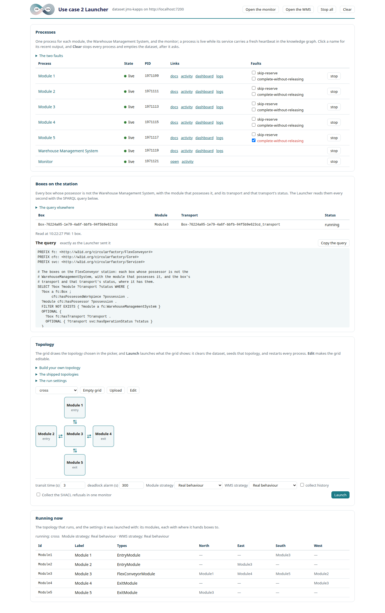
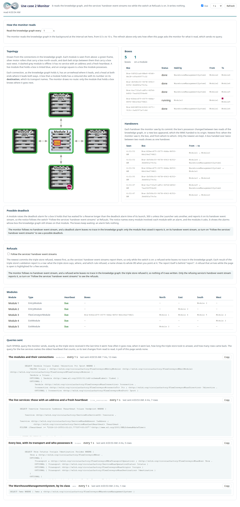

# Use Case 2: A Decentralized Conveyor Network Coordinated through a Constraint-Enforced Knowledge Graph

## Overview

This use case is Section 5.2 of the paper. It shows these requirements of Table 3 of the paper:

| Requirement | Where to observe it |
|---|---|
| R4 | the IRIs in the answer of query Q1, and `tests/test_no_deletion_of_individuals.py` |
| R8 | [Hop log](#hop-log), the spawn and the end of the transport |
| R9 | [Fault refusals](#fault-refusals) |
| R10 | [Knowledge graph queries](#knowledge-graph-queries) and [Code](#code) |
| R14 | [Possession history](#possession-history) |

It is a decentralized conveyor network that a constraint-enforced knowledge graph
coordinates. Each FlexConveyor module runs as its own process, a service.

The warehouse management system (WMS) injects a box on its origin module. The box goes from module
to module to its destination, and the destination gives it back to the WMS. There is no central
router: each module selects the next module of a box from the knowledge graph. Before each call, a
module finds the workflow endpoint of the peer in the knowledge graph.

The knowledge graph holds the factory information state of the use case: which module possesses
which box, and where the transport of each box is. The triple store admits or refuses each commit
to it by SHACL validation, before the act that the commit describes.

Two faults of the domain logic of a module make it commit a write that can break a physical
invariant, and the triple store refuses each such write.

The conveyors are simulated. The call of the Receive workflow of the next module stands for the
light barriers that detect an arriving box.

## Run

Do the [setup](../README.md#setup) first. Then, in the root of the clone and in the same
terminal:

```shell
uv run jms-uc2
```

Stop use case 1 first if it runs on the same dataset.

## Pages and logs

### Launcher page

The page is <http://127.0.0.1:8090/>. The topology section of the page launches a topology:

1. In the first row, the picker selects a topology.
2. **Launch** launches the selected topology: it clears the dataset, and starts each process again.



### WMS dashboard

The button *Open the WMS* opens the dashboard of the WMS on its tab *WMS*.

- *Spawn a box* spawns one box, from an origin to a destination. You select them on the dashboard,
  or the WMS selects them.
- *Spawn rate* spawns boxes on its own, at the given number each minute, until you set it to 0.

### Monitor

The button *Open the monitor* opens the monitor.

It draws the modules as the knowledge graph connects them. It draws each box on the module that
possesses it, and a disc on the destination of the box. A box has a UUID of its own as its name,
`Box-<UUID>`. The disc and the square of the box show the first four characters of the UUID.

Its view *Refusals* shows each write that the triple store refused. It gives the message of the
refusing shape, the focus node, the path and the value, and the full validation report behind
*report*.

With the switch *Follow the services' handover event streams* off, the refusals go, because a
refused write leaves no trace in the knowledge graph.



### Hop log

The terminal and the activity page of each module show the logs. Spawn a box on the dashboard of
the WMS, and follow it from Module1 to Module3.

`Box-<UUID>` is the name of the box, the same in each line of its transport.

- The giver logs `Module1: Module3's ReserveWorkflow accepted Box-<UUID>`, then
  `Module1: conveyed Box-<UUID> to Module3`.
- The receiver logs `Module3: ReserveWorkflow accepted Box-<UUID> from Module1` and
  `Module3: ReceiveWorkflow accepted Box-<UUID> from Module1`.

Between the Reserve and the move, the giver commits the change of possession. The receiver then reads the box and its
transport from the knowledge graph, and carries the box on. The commit of the spawn notifies Module1,
the origin, and the commit that ends the transport notifies the WMS. *Test:*
`tests/test_uc2_journey.py::test_a_spawn_and_a_hop_each_make_one_commit_between_their_calls`.

## Demonstrations

### Fault refusals

The shapes in `src/jms_kapps/uc2/shapes/flexconveyor_usecase_shapes.ttl` tie the possession of a
box to its transport: a module possesses at most one box, a box has exactly one possessor, the box
of a running transport is possessed by exactly one module, and the box of a done transport by
none. `uv run pytest tests/test_uc2_shapes.py --dataset <name>` checks each shape.

The fault injection of the paper is two switches in the row of each module on the Launcher page.
A module starts with both off.

Tick *Collect the SHACL refusals in one monitor* before the launch. With the switch *Follow the
services' handover event streams* of the monitor off, the monitor shows no refusal.

1. **Fault scenario 1, `skip-reserve`:** the module gives a box to the next module without a
   Reserve of that module.
   1. On the Launcher page, launch the topology `merge-fault-demo`, a merge of two streams.
   2. Arm `skip-reserve` on Module5.
   3. Open the WMS, and set *Spawn rate* to 30 boxes a minute.

   Module5 soon gives a box to Module6 while Module6 still holds the box before it. The triple
   store refuses that handover by `FlexConveyorModulePossessionShape`, "A FlexConveyorModule may
   possess at most one Box at a time.". The *Refusals* of the monitor shows it. Module5 logs a
   WARNING, `Module5: the triple store refused handing Box-<UUID> to Module6 [...]`, with the
   report.

   Directly after, the monitor still shows the box on Module5, and the box of Module6 on Module6:
   nothing moved. Then Module5 asks the Reserve of Module6, and waits its turn:
   `Module5: Module6 refused to reserve: occupied by [...]; asking again in 1 s`. It logs
   `Module5: conveyed [...] to Module6` only after Module6 accepts: onto the free Module6, the triple store
   admits the same handover. Then the box arrives. Set the rate back to 0.
2. **Fault scenario 2, `complete-without-releasing`:** the module is the destination of a box. It
   commits the transport of the box `done` before it gives the box back. Arm it on Module4, the exit
   of `merge-fault-demo`, and spawn a box to Module4. The triple store refuses the commit by
   `DoneTransportBoxReleasedShape`, "The Box of a done BoxTransportOperation must not be possessed
   by a FlexConveyorModule.". Then the module gives the box back correctly.

Listing 1 of the paper is the refusal of a handover onto an occupied module, recorded.
[The recorded refusal](recorded-refusal.md) gives the validation report as the triple store sent
it (`tests/reports/skip-reserve.nq`), its Turtle form (`tests/reports/skip-reserve.ttl`), the
command that records it again, and its provenance.

### Possession history

The history of the triple store holds each change, each with the transaction that made it, and the
time of that transaction. GraphDB's history plugin keeps this history. The trace below comes from
the history of the triple store, not from the knowledge graph.

`jms-uc2 trace-box` runs use case 2 with four modules in a line, the topology `line`. It sends one
box from Module1 to Module4, and reads each change of its possession back from the history. Its
dataset, `--dataset`, must have a name that starts with `ogm-disposable-`. It clears that dataset at its
start, and turns its history collection on for good.

**Create a disposable dataset** one time, from `graphdb/jms-kapps-repo-config.ttl` in the clone,
with only its ID changed, here to `ogm-disposable-trace`.

- On the local triple store of `compose.yaml`, which answers on port 7200 unless
  `JMS_KAPPS_GRAPHDB_PORT` names another:

  ```bash
  sed 's/"jms-kapps"/"ogm-disposable-trace"/' graphdb/jms-kapps-repo-config.ttl > trace-config.ttl
  curl -X POST http://localhost:7200/rest/repositories -F config=@trace-config.ttl
  ```

  On Windows, copy the file, and change `"jms-kapps"` in it to `"ogm-disposable-trace"` in an
  editor. Then send it with `curl.exe` in place of `curl`.
- On a triple store of your own, create the dataset from the same file, with its ID changed, as
  [Dataset](setup.md#dataset) tells. The command clears the dataset. Thus on a triple store that is
  not on this machine, set `TRIPLESTORE_ALLOW_DESTRUCTIVE=1` for it.

Then run it:

```bash
uv run jms-uc2 trace-box --dataset ogm-disposable-trace
```

It prints one row for each transaction that changes one of these items:

- the possession of the box
- the status of its transport
- the module that its transport is assigned to (`cfc:executedOn`)

From a run on the local triple store:

```text
time (UTC)               time (server)                  box                                       possessor                   status   assigned module  transaction
-----------------------  -----------------------------  ----------------------------------------  --------------------------  -------  ---------------  -----------------
2026-10-24 11:05:30.484  2026-10-24 11:05:30.484+00:00  Box-8aa68034-418d-4efe-9be2-8abb70aad28f  Module1                     queued   Module1          20261024110530484
2026-10-24 11:05:30.872  2026-10-24 11:05:30.872+00:00  Box-8aa68034-418d-4efe-9be2-8abb70aad28f  -                           running  -                20261024110530872
2026-10-24 11:05:31.246  2026-10-24 11:05:31.246+00:00  Box-8aa68034-418d-4efe-9be2-8abb70aad28f  Module2                     -        Module2          20261024110531246
2026-10-24 11:05:32.862  2026-10-24 11:05:32.862+00:00  Box-8aa68034-418d-4efe-9be2-8abb70aad28f  Module3                     -        Module3          20261024110532862
2026-10-24 11:05:34.465  2026-10-24 11:05:34.465+00:00  Box-8aa68034-418d-4efe-9be2-8abb70aad28f  Module4                     -        Module4          20261024110534465
2026-10-24 11:05:36.029  2026-10-24 11:05:36.029+00:00  Box-8aa68034-418d-4efe-9be2-8abb70aad28f  WarehouseManagementSystem1  done     -                20261024110536029

possessors from the history: Module1, Module2, Module3, Module4, WarehouseManagementSystem1
possessors from the logs:    Module1, Module2, Module3, Module4, WarehouseManagementSystem1
the history and the logs agree; the trace is in trace-Box-8aa68034-418d-4efe-9be2-8abb70aad28f.json
```

- The first row is the spawn. One transaction creates the box on Module1, with its transport
  `queued`, and assigns the transport to Module1. The second row is the start of the transport by
  Module1.
- Each handover between modules is one transaction. The possession of the box and the assignment of
  the transport go to the next module together.
- The last row is the give-back. One transaction makes the WMS the possessor, and the transport
  `done`.
- **The cross-check** compares the possessors, in the sequence of their transactions, with the
  handovers that the services logged: the `spawned ... onto Module1` of the WMS, the `conveyed ... to`
  of each module, and the `accepted ... back` of the WMS. The command exits 0 when they agree, and 1
  if not.

It writes the same rows and the cross-check as JSON, to `--out`, or to `trace-<box>.json` in the
current folder.

### Knowledge graph queries

Two queries for the [workbench](setup.md#triple-store-workbench), on the
dataset of the run, `jms-kapps`. In the queries, `fc:` is the use case's namespace, written `:`
elsewhere. **Q1** lists each module of the running topology, as a Core
resource and a FlexConveyor module. It finds them only where the ontology states that a FlexConveyor
module is a Core resource:

```sparql
PREFIX fc: <http://w3id.org/circularfactory/FlexConveyor#>
PREFIX cfc: <http://w3id.org/circularfactory/Core#>
PREFIX rdfs: <http://www.w3.org/2000/01/rdf-schema#>
SELECT ?module WHERE {
  fc:FlexConveyorModule rdfs:subClassOf cfc:Resource .
  ?module a cfc:Resource , fc:FlexConveyorModule .
}
ORDER BY ?module
```

**Q2** lists the service of each module, its address, and its workflows with their endpoints. A
column stays empty where the knowledge graph holds no value. After a stop, the address and the
endpoints are empty.

```sparql
PREFIX fc: <http://w3id.org/circularfactory/FlexConveyor#>
PREFIX svc: <http://w3id.org/circularfactory/Service#>
SELECT ?module ?address ?workflow ?endpoint WHERE {
  ?module a fc:FlexConveyorModule .
  ?service svc:isServiceOf ?module .
  OPTIONAL { ?service svc:hasAddress ?address }
  ?step svc:isWorkflowOf ?service ;
        a ?workflow .
  FILTER(STRSTARTS(STR(?workflow), STR(fc:)))
  OPTIONAL { ?step svc:hasEndpoint ?endpoint }
}
ORDER BY ?module ?workflow
```

## Code

The ontology of use case 2 is
[`flexconveyor_usecase.ttl`](../src/jms_kapps/uc2/ontology/flexconveyor_usecase.ttl), and its
shapes are [`flexconveyor_usecase_shapes.ttl`](../src/jms_kapps/uc2/shapes/flexconveyor_usecase_shapes.ttl).
Two modules write the transport and the handover:

- **`src/jms_kapps/uc2/transport.py`, the transport.** `TransportRecords.open` creates the box, its transport, `queued` and assigned to the origin, and the first
  possession of the box. `start`, `complete` and `fail` are each a `mw.commit()` of the status of the
  transport. `complete` is also the write of fault scenario 2. The normal `done` joins the commit
  of the last handover. These writes appear in the *Transports* of the WMS, and in the table of the
  boxes of the monitor.
- **`src/jms_kapps/uc2/handshake.py`, the handover.** `Giver.hand_over` opens the `handover()` of the middleware.
  Its entry commits the change of possession together with the new assignment of the transport.
  The move of the box runs inside it, only after the triple store admits that commit. A refusal
  arrives here as the `ShaclValidationError` of the triple store access module, with the validation
  report of the triple store.

A module reads the workflows of its peers, the connections and what each module possesses from the
knowledge graph when it needs them, through `src/jms_kapps/uc2/discovery.py`.

No service writes past its middleware instance. `tests/test_uc2_writes.py` reads each module of
`src/jms_kapps`, and finds no other direct write.
